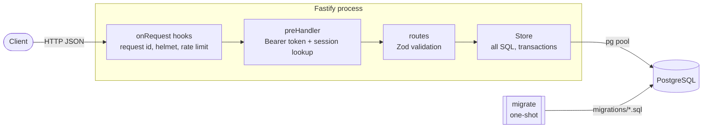

# fastify-postgres-boilerplate

One of three implementations of the same loan API: [Express + MongoDB](https://github.com/the-vishal-kumar/nodejs-typescript-rest-boilerplate), **Fastify + PostgreSQL** (this repo) and [Go + PostgreSQL](https://github.com/the-vishal-kumar/go-postgres-boilerplate). They share one contract and one conformance suite, and are [measured side by side](https://github.com/the-vishal-kumar/nodejs-typescript-rest-boilerplate/blob/main/docs/comparison.md).

[](https://github.com/the-vishal-kumar/fastify-postgres-boilerplate/actions/workflows/ci.yml?query=branch%3Amain)


[](./LICENSE)

## Problem

Customers request a loan with an amount and a term in weeks. An admin approves it. The customer repays it in weekly instalments, in order, and the loan becomes `PAID` with the last one.

The rules are small but real:

- **Exact money.** Amounts have at most two decimals and are stored in integer cents. A schedule splits the amount into equal instalments with the remainder on the last one, so it always adds up (10000 over 3 is 3333.33, 3333.33, 3333.34).
- **Approval rules.** Only an admin approves, never their own loan, and never twice.
- **Ordered repayments.** A payment must cover the next instalment and may not exceed the balance; any surplus pays the following instalments.
- **Concurrency.** Two payments racing on one loan must never apply money twice or lose it.

The full behaviour is the [OpenAPI contract](./contract/openapi.json) plus the [conformance suite](https://github.com/the-vishal-kumar/nodejs-typescript-rest-boilerplate/tree/main/conformance), which this repo passes in CI.

## Design



- **Fastify 5** with its own JSON body parser (empty body means `{}`, 10 KiB limit), `@fastify/helmet` and `@fastify/cors`. Errors from anywhere become one envelope in a single error handler.
- **Validation with Zod.** Each route parses params and body into typed values; Zod issues are translated into the contract's messages (`"amount" is required`).
- **PostgreSQL with plain SQL** through `pg`, no ORM. [`src/store.ts`](./src/store.ts) holds every query. Money is `bigint` cents, statuses are enum types, and email uniqueness is a unique index on `lower(email)`.
- **Migrations** are SQL files in [`migrations/`](./migrations), applied by a one-shot `migrate` container before the API starts. The migrator records versions in `schema_migrations` and holds an advisory lock, so replicas starting together cannot race.
- **Repayment concurrency:** one transaction that locks the loan row (`SELECT ... FOR UPDATE`), reads the pending instalments, applies the payment and commits. A second payment waits for the lock and then sees the first one's result, so both apply in sequence. Approval uses a conditional `UPDATE ... WHERE status = 'PENDING'`.
- **Auth:** HS256 JWTs signed with `node:crypto` (one algorithm, no `alg` negotiation). The database stores only a SHA-256 of each token, so sign-off and password reset can revoke sessions. Passwords use scrypt.
- **Operations:** `/health/live` never touches the database, `/health/ready` pings it and fails while shutting down. SIGTERM fails readiness, drains in-flight requests, closes the pool and exits 0. Configuration comes only from the environment and is validated at start-up, with every problem reported at once.

## Trade-offs of this stack

- **Relational guarantees for free.** Unique emails, foreign keys, check constraints and the row lock live in the database. The Express + MongoDB version needs a lease document to get the same repayment guarantee, because a standalone MongoDB has no multi-document transactions.
- **SQL without an ORM** keeps every query visible and reviewable, at the cost of mapping rows to objects by hand. For this many tables that is cheaper than an ORM's abstractions and migrations.
- **Zod over Fastify's JSON Schema validation.** JSON Schema would compile faster validators and could feed the OpenAPI document, but the contract's messages and numeric-string conversion fit Zod with less glue, and Zod gives handlers static types. The cost is a small translation layer for messages.
- **Single-process rate limits.** Limits are kept in memory, per process. Several replicas need a shared store such as Redis.
- **Node.js runtime.** The image carries a Node runtime (larger than a Go binary) and sign-in is bound by scrypt on the event loop's thread pool. The [comparison](https://github.com/the-vishal-kumar/nodejs-typescript-rest-boilerplate/blob/main/docs/comparison.md) has the measured numbers.

## Quick start (Docker only)

```bash
git clone https://github.com/the-vishal-kumar/fastify-postgres-boilerplate.git
cd fastify-postgres-boilerplate
make up        # API and PostgreSQL on http://localhost:3000, docs at /docs
make down
```

Every target runs in containers; the host needs only Docker and make.

| Target | What it does |
|---|---|
| `make lint` | Prettier check and ESLint |
| `make typecheck` | `tsc --noEmit` |
| `make build` | Compile to `build/` |
| `make test` | Unit and integration tests against a throwaway PostgreSQL |
| `make conformance` | Fresh stack plus the shared conformance suite |
| `make image` / `make scan` | Production image; Trivy scan for fixable HIGH/CRITICAL CVEs |
| `make bench` | The shared k6 load test (see below) |

Configuration lives in [`.env.sample`](./.env.sample); `make up` copies it to `.env` on first run.

## Conformance suite and benchmark

The conformance suite and the load test live in the [reference implementation](https://github.com/the-vishal-kumar/nodejs-typescript-rest-boilerplate/tree/main/conformance), released by the `conformance-v1` tag. `make suite` fetches that tag into the git-ignored `.cache/` with a git container, so there is one copy and no vendored drift.

- `make conformance` starts a fresh stack (with `ADMIN_SIGNUP_ENABLED=true` and `TRUST_PROXY=1`) and runs the suite with `node --test`. It also checks that `/docs/openapi.json` is the contract with only the title and description changed.
- `make bench` runs the k6 mix (sign-in, loan request, list, get, admin approval, repayment) under the CPU and memory limits in [`compose.bench.yaml`](./compose.bench.yaml), which all three implementations share. Results go to `.cache/bench/result.json`.

Cases that need the database or the process are covered by this repo's own tests in [`test/integration`](./test/integration): tokens stored only as hashes, expired sessions, 500 without internals when the database fails, readiness while shutting down, admin sign-up switched off, the recorded approver and racing payments.

## CI

[`.github/workflows/ci.yml`](./.github/workflows/ci.yml), actions pinned by commit SHA:

1. Prettier, ESLint, type-check, unit and integration tests against a PostgreSQL service.
1. Image build, compose up (migrations first), the conformance suite, a smoke test, a check that SIGTERM exits 0, and a Trivy scan.

## History

This repo started in 2020 as a Fastify + Sequelize CRUD boilerplate. In 2026 it was rewritten from scratch as the PostgreSQL implementation of the loan API; the earlier commits remain in the history.

## License

[MIT](./LICENSE), Vishal Kumar.
